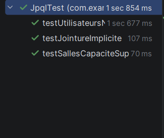
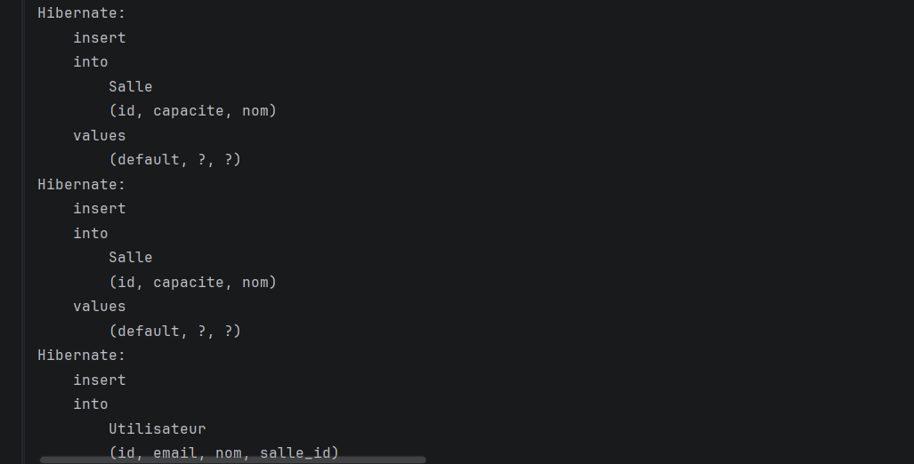
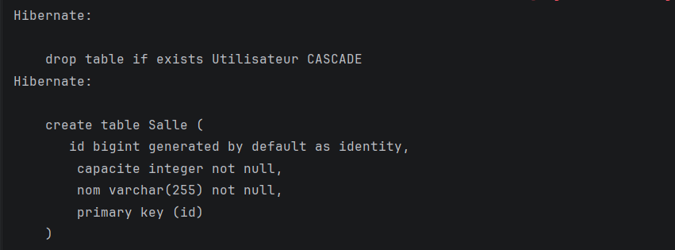
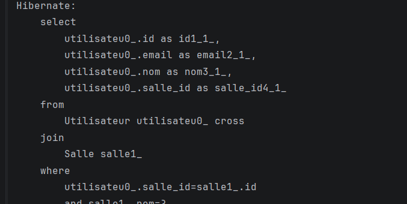

# Résultats

## Tests JPQL
Les trois tests de `JpqlTest` passent avec succès.

## Requêtes d'insertion
Requêtes `insert into` générées par Hibernate.

## Création des tables
Création automatique de la table `Salle` à partir de l'entité.

## Requête de sélection avec jointure
Requête `select` avec jointure entre `Utilisateur` et `Salle`.

